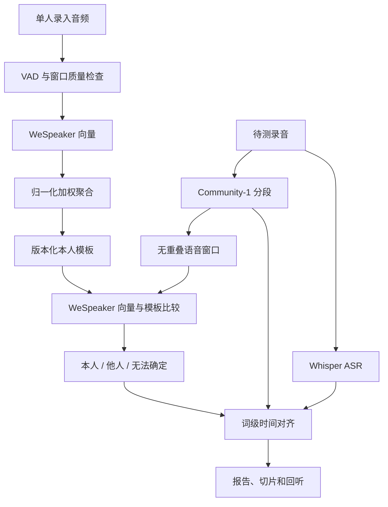

# 声纹识别 Demo 技术方案

记录日期：2026-10-23。状态：简化方案实现；横向对比后续补齐。

## 目标与范围

用户目标是验证 pyannote 相关组件能否在实际录音中将本人声音与其他人区分，并最终评估商用可能性。本阶段提供本地 Python Demo：声纹录入、单人声音验证、多人说话人分段、ASR 和身份标记。默认中文、离线文件处理。

“本人/他人”是针对一个选定 profile 的验证问题。系统存储多个 profile，但每次只比较用户选中的一个，不做全库 1:N 身份检索。录音可以没有本人，不能强制选择最相似的人作为本人。

## 组件与职责

| 组件 | 使用方案 | 职责 |
|---|---|---|
| 音频解码 | soundfile + scipy，格式回退 PyAV | 单声道、16 kHz、统一相对时间轴 |
| 语音检测 | Silero VAD，ONNX | 选择语音区间，排除静音 |
| 声纹 | pyannote/wespeaker-voxceleb-resnet34-LM | 生成用于身份验证的 embedding |
| 分段 | pyannote/speaker-diarization-community-1 | 生成匿名说话人时间区间与 exclusive 区间 |
| 转写 | faster-whisper + Whisper large-v3 | 文本和词级时间戳；可通过配置替换 ASR 权重 |
| 应用逻辑 | VoiceService + core | 模板聚合、余弦比较、拒识、时间对齐、导出 |
| 界面 | Gradio | 录入、验证、分析、回听和下载 |
| 存储 | 本地 JSON + WAV | 轻量实验，无数据库部署要求 |

最初方案讨论中的 FastAPI 独立 worker、SQLite 暂不引入。Gradio 已提供本地 HTTP 服务；CLI 和 UI 共用 VoiceService，后续可再封装 FastAPI。这样第一版更容易安装、测试和检查结果。

WeSpeaker 是本次通过 pyannote 调用的具体声纹模型，不能把它的识别结果泛称为整个 pyannote 产品的声纹准确率。Community-1 的匿名标签只在单份录音内有效，不是稳定用户 ID。

## 流程

单段验证会绕过 Community-1 和 ASR，直接对用户确认的单人录音进行 VAD、embedding 和模板比较，用于尽量隔离分段及转写误差。

## 录入策略

建议每人 3～5 段，每段 10～20 秒，内容不同，尽量跨录制会话。实现允许 1～10 个文件，要求可用窗口累计至少 10 秒。

1. 将音频转为 mono float32 / 16 kHz。当前实现会对多声道取平均；已知每声道独立说话人的录音，应先按声道拆开使用，尚未实现自动通道利用。
2. Silero 输出语音时间区间。
3. 每个连续区间均匀分成不超过 5 秒的窗口，长度不足 1.5 秒的区间忽略。不跨静音拼接。
4. 跳过削波比例超过 2% 的窗口。
5. 提取并归一化各窗口向量，按有效时长加权平均，再归一化形成模板。
6. 保存模板及各窗口向量、来源文件序号、时长、质量信息、模型标识和 Hugging Face 权重 revision。

上述时长、削波阈值是工程初始值，未作业务校准。界面要求用户确认单人录入；当前没有可靠的自动多人检查。模板窗口相似度可用于人工检查一致性，但不构成录入身份保证。

## 比较与拒识

设已归一化的待测向量为 x，本人模板为 p，则余弦相似度为 x·p。

默认规则：

- 可用窗口累计不足 3 秒：unknown。
- 多个窗口中同时出现分数 ≥ 0.70 和 ≤ 0.45：unknown，原因 conflicting_windows。
- 聚合分数 ≥ 0.70：self；≤ 0.45：other；其余 unknown。

分数不是概率。两阈值从环境变量读取，报告总是注明默认配置尚未校准。模型 fingerprint 包含权重 revision、pyannote.audio 版本和预处理版本；不匹配时拒绝比较，要求重新录入。

当前不做自动模板更新，避免误认样本污染声纹。修改模板聚合或预处理算法时应更新版本并重新建立模板。

## 分段、重叠与 ASR

Community-1 的普通分段用于计算真实重叠，exclusive 输出用于给词分配一个说话人。用时间事件扫描计算“恰好一个说话人活动”的区间，再与 VAD 相交，按匿名说话人聚合 embedding。

窗口高低分冲突时拒识；但这不能保证检测出所有混簇，分段错误仍可能传播到簇内短语音。报告同时保留窗口、簇、原始 turn 和词级结果。

ASR 在同一份完整波形上独立运行，开启词级时间戳和 VAD filter。每个词分配给覆盖时间最长、且覆盖比例至少 50% 的 exclusive 说话人；平局、无充分覆盖、重叠发言或缺少词级时间戳时不强制分配身份。

导出每个普通 diarization turn 的 WAV。它只是从原混音截取；没有语音分离。含重叠的整个导出 turn 保守显示 unknown，而词级结果按词与重叠区间是否相交处理。

## 输出与数据管理

模板包含 profile_id、名称、创建时间、模型 fingerprint、centroid、逐窗口向量、录入质量与模板相似度。原始录入音频不进入模板库。

分析报告包含 profile_id、逐说话人匹配结果、窗口分数、原始分段、exclusive 分段、重叠区间、词级转写、配置、耗时和运行依赖版本。导出文件通过随机 job ID 隔离。

Gradio 事件共用一个模型并发组，同一进程中串行执行模型任务。模型按需加载并复用。单文件上限 200 MB，默认最长 30 分钟。模板写入采用临时文件原子替换；文件名由随机 ID 生成，不使用用户名称拼路径。

仅监听 localhost，不启用公网分享。下载模型需要联网，实际推理在本地。禁用 pyannote 和 Gradio 的可配置使用指标上报。模型缓存及界面临时副本默认放到 data/。声纹、录音片段和文本未做应用层加密；本地权限和文件生命周期由使用者管理。删除模板不会删除其他历史结果。

## 评测设计

分层评测：

1. 人工确认的单人录音验证 embedding：FAR、本人漏识、拒识率、覆盖率。
2. 有说话人时间标注的完整录音验证分段：DER，包含/不包含重叠时分别报告。
3. 原始音频端到端验证：本人语音时长召回、他人误归时长、转写 CER、延迟和成本。

当前 evaluate 命令实现第 1 层固定阈值的基础统计，所有 unknown 留在分母，本人 unknown 计入漏识。按 condition 分组；坏文件或运行错误使任务失败。EER/ROC、DER/CER、置信区间和阈值拟合未在本阶段实现。

录入与测试隔离录音会话；开发集用于选阈值，最终测试集用于验收。多用户产品还应隔离开发集和测试集的说话人。测试 1/2/3/5/10 秒语音、跨设备、跨日期、噪声、远场、重叠和本人缺席。初步可用 20～30 人做功能探索，商用评估需扩大且报告统计不确定性。

普通转写身份标注可讨论的初始项目目标为：目标场景下 FAR ≤ 1%、本人漏识 ≤ 5%、覆盖率 ≥ 90%，同时报告困难条件。它们不是已达到的结果，也不是通用商用标准。身份认证场景还需要反重放和合成语音检测，本 Demo 不支持。

## 后续横向对比

`AudioBackend` 定义提取向量等接口。未来将 embedding 后端进一步拆成可配置适配器，增加 SpeechBrain ECAPA-TDNN 或其他模型，保持相同测试清单。

每套模型独立生成录入模板、独立校准阈值；不能跨模型比较向量。对比的是相同音频上的 FAR、漏识、覆盖率、时长分桶和耗时。先固定分段和 ASR，仅替换声纹模块；再做完整系统比较，避免混淆误差来源。

商业 pyannoteAI voiceprint API 是另一种后端，需独立授权和评估成本、数据传输与模板格式。当前没有接入。

## 官方参考资料

- [pyannote.audio](https://github.com/pyannote/pyannote-audio)：工具包代码、安装与本地 pipeline。
- [Community-1](https://huggingface.co/pyannote/speaker-diarization-community-1)：分段输入、exclusive 输出、访问条件；模型卡标注 CC-BY-4.0。
- [WeSpeaker 封装模型](https://huggingface.co/pyannote/wespeaker-voxceleb-resnet34-LM)：embedding 调用方式；模型卡标注 CC-BY-4.0。
- [faster-whisper](https://github.com/SYSTRAN/faster-whisper)：ASR、词级时间戳、设备选择。
- [Silero VAD](https://github.com/snakers4/silero-vad)：语音活动检测。
- [SpeechBrain ECAPA](https://huggingface.co/speechbrain/spkrec-ecapa-voxceleb)：后续候选对照模型。
- [pyannoteAI voiceprints](https://docs.pyannote.ai/tutorials/identification-with-voiceprints)：商业服务，与开源接口分开。

代码许可、模型权重许可及数据使用条件应分别核对；这里只记录所用组件及模型卡声明，不把开源代码许可当作全部商用条件。
